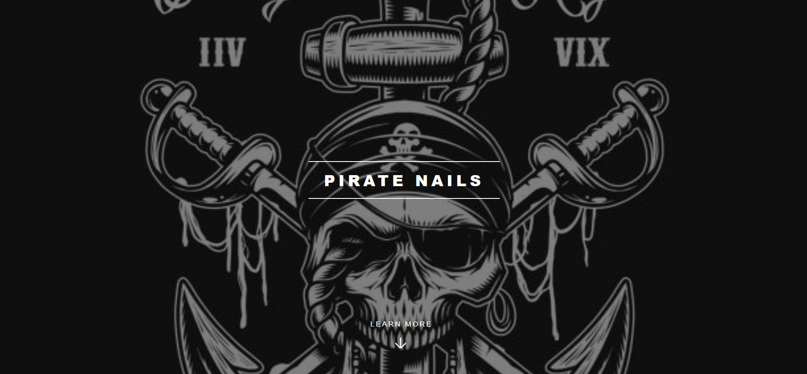

# Pirate Nails

A one-page website for **Pirate Nails**, a nail salon. I listened to what the salon wanted, suggested ideas of my own, and built a simple site that presents the services and prices.

## Sections

- **Banner** – full-screen pirate-themed hero with a *Learn More* button that scrolls down smoothly
- **Intro** – the salon's mission
- **Highlights** – three image + text blocks: nail preparation, nail resistance, various models
- **The Ideal Manicure** – price table with 5 services (20–50 €)
- **Contact form** – name, email and message
- **Footer** – social icons

## Tech

- HTML5 and CSS3, responsive on desktop, tablet and phone
- jQuery plugins for smooth scrolling (`scrolly`) and scroll effects (`scrollex`)
- Font Awesome icons

## How to run

Open `index.html` in your browser. The contact form is for show and doesn't send messages yet.

## Credits

Based on the [Spectral](https://html5up.net/spectral) template by [HTML5 UP](https://html5up.net), used under the [CCA 3.0 license](https://html5up.net/license).
